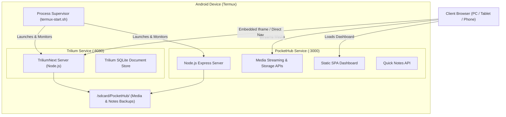

# 📱 Design Specification: PocketHub & Trilium Dual-Service Integration

*Date: October 19, 2026*  
*Author: Antigravity & Raj Varu*  
*Target Environment: Android Termux (ARM64) / Wi-Fi Hotspot / Modern Web Browsers*

---

## 1. Executive Summary

This specification defines the architectural design for integrating **TriliumNext** (the community continuation of Trilium Notes) with **PocketHub** in an Android Termux environment.

The system adopts a **dual-service, unified-navigation architecture**:
* **PocketHub (Port 3000)**: Serves the media hub (video streaming with HTTP 206 range requests, background audio playback, disk storage calculation, and quick scratchpad notes).
* **Trilium (Port 8080)**: Serves the full-featured hierarchical knowledge base (arbitrary tree depth, rich formatting, code notes with syntax highlighting, drawing canvas, revision history).
* **Unified Web Dashboard**: PocketHub's web client features an embedded Trilium view with dynamic hostname detection (`http://<hostname>:8080`) and an "Open in New Tab ↗" escape hatch, allowing the user to take deep hierarchical notes while music plays in the background—all accessible via their phone's hotspot.
* **Termux Automation**: Provides automated installation (`setup-trilium.sh`) via `proot-distro` (Debian ARM64) to bypass Android Bionic libc compilation hurdles, and an enhanced process manager in `termux-start.sh` that launches both services with unified signal handling and shutdown.

---

## 2. Goals & Non-Goals

### Goals
1. **Full Trilium Capability**: Deliver 100% of Trilium's power (deep tree, code notes, revision history) on Android.
2. **Unified Navigation**: Access both services seamlessly from a single web dashboard on computers or secondary phones over Wi-Fi/Hotspot.
3. **Continuous Audio**: Keep background music playing while writing notes in Trilium.
4. **Independent Ports**: Ensure both `http://<ip>:3000` and `http://<ip>:8080` can be accessed independently or together.
5. **Clean Mobile Lifecycle**: Ensure one-command startup (`./termux-start.sh`) and instantaneous, clean termination of both services on `Ctrl + C`.

### Non-Goals
* Merging Trilium's 200,000+ lines of source code directly into PocketHub's codebase (which would break PocketHub's zero-dependency footprint and bloat memory).
* Re-implementing Trilium's custom backend scripting sandbox inside PocketHub.
* Requiring root access on Android.

---

## 3. System Architecture



---

## 4. Detailed Component Design

### 4.1 Frontend Navigation & Embedded View

In [`public/index.html`](file:///E:/My%20Custom%20softwares/TermuxCombine/public/index.html) and [`public/app.js`](file:///E:/My%20Custom%20softwares/TermuxCombine/public/app.js):

1. **Sidebar Navigation**:
   * **Trilium Notes**: Dedicated navigation item with an icon and badge.
   * **Quick Notes**: Existing lightweight note scratchpad remains available for quick thoughts without waiting for Trilium's full workspace to boot.
2. **Trilium Viewport (`#view-trilium`)**:
   * **Top Action Bar**:
     * Title indicator: "Trilium Knowledge Base" with connection status dot.
     * **"Open in New Tab ↗"** button: Opens `http://<hostname>:8080` in a dedicated browser tab.
     * **"Reload 🔄"** button: Refreshes the iframe if needed.
     * **Port Indicator**: Shows `Port: 8080`.
   * **Responsive Container**:
     * Full-height embedded `<iframe>` pointing dynamically to `http://${window.location.hostname}:8080`.
     * Attributes: `allow="clipboard-read; clipboard-write; fullscreen"` for seamless note editing and image pasting.
   * **Empty/Offline State**:
     * If Trilium is not running or still starting, the viewport displays a friendly helper card with setup instructions and a "Retry Connection" button.

### 4.2 Termux Automation & Installer

#### `setup-trilium.sh`
* Checks for `proot-distro` in Termux.
* Installs `debian` or `ubuntu` inside PRoot if not present:
  ```bash
  pkg install -y proot-distro
  proot-distro install debian
  ```
* Downloads the official `TriliumNotes-Server-*-linux-arm64.tar.xz` release or installs via npm inside PRoot.
* Creates a shared data symlink or storage directory in `/sdcard/PocketHub/trilium-data/` so notes are safely stored in Android's shared storage.

#### Enhanced `termux-start.sh`
* Checks if Trilium is installed:
  * If installed: Starts Trilium in the background on port `8080` and stores its PID.
  * If not installed: Informs the user that Trilium can be installed via `./setup-trilium.sh` and continues running PocketHub.
* Starts PocketHub on port `3000`.
* Traps `SIGINT` and `SIGTERM`:
  * Kills both PIDs cleanly.
  * Ensures zero zombie background processes on Termux.
* Prints clear, formatted URLs for both services:
  ```
  📱 PocketHub:  http://192.168.43.1:3000
  📚 Trilium:    http://192.168.43.1:8080
  ```

---

## 5. Security & Network Considerations

1. **Same-Origin / Iframe Policy**:
   Trilium by default may configure security headers. The iframe embeds directly via `http://<hostname>:8080`. Modern browsers allow cross-port iframes on the same origin/host unless forbidden by CSP `frame-ancestors`. If needed, a lightweight reverse proxy route `/trilium/` in PocketHub can proxy port 8080 directly under port 3000 with stripped frame restrictions.
2. **Local Hotspot Trust Model**:
   Both services operate without passwords for personal hotspot convenience, matching the user's explicit design requirement.

---

## 6. Implementation Milestones

1. **Milestone 1**: Update PocketHub Web Dashboard with Trilium View, dynamic hostname port resolution, and "Open in New Tab" navigation.
2. **Milestone 2**: Create `setup-trilium.sh` installation script for Android Termux.
3. **Milestone 3**: Upgrade `termux-start.sh` to supervise both services with graceful multi-PID shutdown.
4. **Milestone 4**: Update automated tests and documentation in `README.md`.
